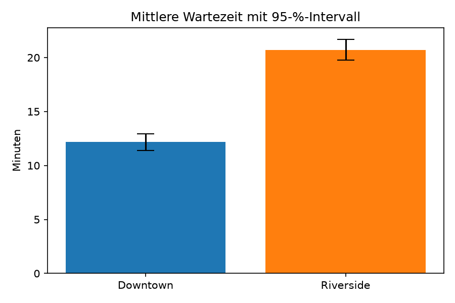

# Was die Daten belegen und was nicht – Statistik-Review für eine Klinikkette

**Python · Hypothesentests · Konfidenzintervalle · Datenaudit · Versuchsdesign**

*Evidence review for a clinic chain: data audit, two hypothesis tests with confidence intervals, and a clear verdict on a flawed A/B test plan.*

> Kursprojekt (Weiterbildung AI Power Data Analyst) mit fiktiven Daten von vier Kliniken. Der Datensatz ist nicht enthalten.

## Die Fragen der Operations-Leitung
1. Kann man dem Besuchslog (1.209 Besuche) trauen?
2. Hält der Standort Downtown sein Versprechen von unter 15 Minuten Wartezeit im Durchschnitt?
3. Wartet man in Riverside wirklich länger als in Downtown?
4. Ist der geplante Test mit SMS-Erinnerungen sinnvoll?

## Ergebnis
- **Datenaudit:** 9 echte Duplikate entfernt, fehlende Zufriedenheitswerte markiert statt gelöscht, Ausreißerregel vor der Auswertung festgelegt. Danach blieben 1.200 Besuche.
- **Downtown:** im Schnitt 12,2 Minuten Wartezeit. Das Versprechen gilt für den Durchschnitt, aber rund 28 % der Patienten warten länger als 15 Minuten.
- **Riverside:** wartet etwa 8,5 Minuten länger, plausibel sind 7,3 bis 9,8 Minuten. Das ist kein Rauschen.
- **SMS-Test:** so nicht durchführen. Standort, Jahreszeit und Auswahl lassen sich nicht trennen. Stattdessen wird ein randomisiertes Design vorgeschlagen.

## Inhalt
- [`Evidence_Review.ipynb`](Evidence_Review.ipynb): Jede Zahl wird von einer Zelle erzeugt.
- [`docs/Evidenz_Review.md`](docs/Evidenz_Review.md): ausführliches Begleitdokument entlang der vier Checkpoints.
- [`docs/Zusammenfassung_Management.pdf`](docs/Zusammenfassung_Management.pdf): zwei Seiten für die Leitung, ohne Fachjargon.

**Tech:** Python, pandas, NumPy, SciPy (t-Tests, Chi-Quadrat-Test, Konfidenzintervalle, Power-Analyse), matplotlib.

---
Fanuel Hintza · Controller mit 8 Jahren Konzernerfahrung · [LinkedIn](https://www.linkedin.com/in/fanuel-hintza)
